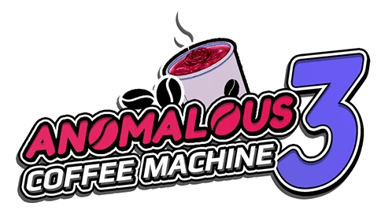
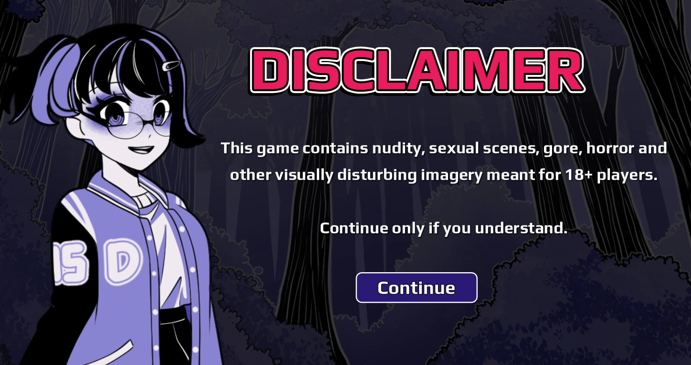
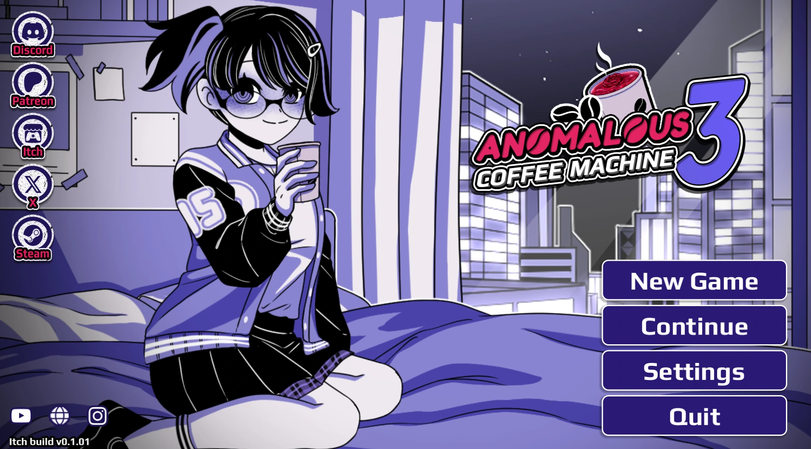
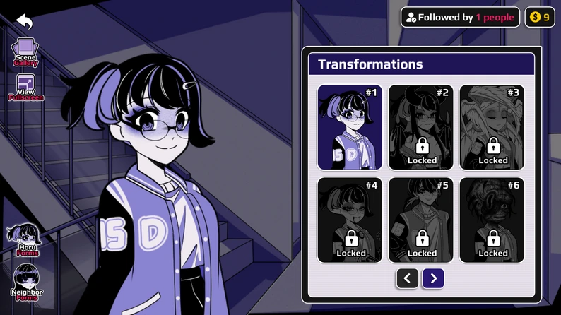
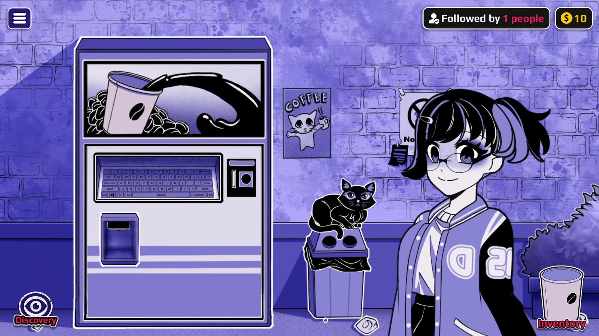

# Anomalous Coffee Machine 3

**Anomalous Coffee Machine 3** is an adults-only interactive fiction, visual novel, and light management game created by HoruBrain. This website lets players aged 18 and over play the free v0.1 browser demo online.

Horu is a work-from-home game artist trying to make rent. In the liminal stairwell between the 12th and 13th floors of her apartment building, she discovers an outdated coffee machine capable of producing drinks that should not exist. Insert a coin, type a word, and see what the machine creates.

## Play Free Online

[Play Anomalous Coffee Machine 3 in your browser](https://anomalouscoffeemachine3.com/)

No installation is required for the browser demo. The game iframe loads only after the player confirms that they are at least 18 years old.

## How to Play

1. Insert a coin and type a keyword into the machine.
2. Receive an anomalous drink based on a recognized object, emotion, place, or idea.
3. Keep the cup, drink it, offer it to a neighbor, or sell it online.
4. Discover new forms, scenes, events, and hidden combinations.
5. Attract followers, earn money, and grow Horu's unusual coffee business.

## Discover Transformations

Experimentation is the heart of the game. Different keywords can unlock drinks, transformations, dialogue, character encounters, and unexpected story outcomes. The forms collection helps track discoveries and shows how many results remain hidden.

## Meet the Neighbors

The sequel expands the original word-and-cup concept into a larger city simulation. Horu can meet other characters, share anomalous drinks, follow new conversations, and see how her experiments affect the people around her.

## Build the Business

Horu's apartment serves as a home base. Manage discoveries and inventory, sell unusual coffee online, watch follower activity, and turn a mysterious machine into a growing late-night business.

## Key Features

- Free v0.1 browser demo.
- Keyword-driven anomalous drink system.
- Interactive fiction, visual novel, simulation, and management elements.
- Inventory choices, character encounters, transformations, forms, and combinations.
- Keyboard, mouse, and touchscreen support.
- English text and subtitles.
- Browser, Windows, macOS, Linux, and Android releases listed by the creator.

## Adults Only

Anomalous Coffee Machine 3 contains explicit sexual content, nudity, disturbing imagery, horror, gore, transformation themes, and other mature material. It is intended exclusively for adults aged 18 and over. Do not play if you are under 18 or if this content is not legal in your location.

## Official Creator Pages

- [HoruBrain — Anomalous Coffee Machine 3](https://horubrain.com/game/anomalous-coffee-machine-3/)
- [Anomalous Coffee Machine 3 on itch.io](https://horubrain.itch.io/anomalous-coffee-machine-3)

> Anomalous Coffee Machine 3, its characters, artwork, and game content belong to HoruBrain and their respective rights holders. This is an unofficial browser portal and is not presented as the developer's official website.

## Before Your First Cup

The browser demo is a starting point for exploring the premise, not a promise that every feature or scene described for other releases is included. Read the current information on the creator's pages when comparing versions. Screenshots help introduce the setting and characters, but they should not be treated as a checklist of everything you will encounter during a particular session.

Begin by paying attention to the instructions shown inside the game. The central idea is easy to understand: a word can produce a drink with an unusual effect. What makes the experience interesting is the uncertainty surrounding that result and the decisions that follow. Take time to read the response rather than treating the machine as a list of answers to complete as quickly as possible.

## Experiment Without Losing the Story

A useful way to approach keyword experiments is to start with a simple idea and then try a related word. Notice whether the game recognizes the input and how it describes the outcome. Not every word needs to produce a unique result. A rejected or unexpected entry is not necessarily a browser problem; the machine's vocabulary and the demo's available content set limits on what can happen.

Keep personal notes if you enjoy comparing discoveries. Recording the words you tried can help you avoid repeating the same experiment accidentally. These notes are your own reference, not a way to unlock content outside the demo or a guarantee that the same result will exist in another version. Let the game's actual responses guide your next step.

The surrounding story gives the experiments context. Horu's everyday concerns sit alongside the machine's impossible products, creating a contrast between ordinary responsibilities and strange possibilities. Conversations, inventory decisions, and the apartment setting help frame those discoveries. Read the dialogue at your own pace rather than skipping directly to another input, especially when a new character or situation appears.

## A Comfortable Browser Session

Choose a private, appropriate setting before starting this adults-only game. The age confirmation is a boundary for access, not a statement that every adult will be comfortable with its themes. You can stop at any time, and you should avoid sharing screenshots or opening the game around people who have not agreed to encounter mature material.

Give the player time to load after confirming your age. A connection problem, blocked embedded content, or browser restriction can prevent the demo from opening. If the frame stays blank, check the browser's messages and the page instructions before trying again. Changing devices or clearing browser data should not be assumed to preserve your progress.

For text-heavy scenes, use a screen size and orientation that let you read comfortably. Touchscreen support does not mean that every phone offers an identical experience. If an input field or control is awkward on a small screen, a desktop browser may be a more practical choice. Follow the controls visible in the game rather than assuming that shortcuts from another visual novel apply.

## Explore Responsibly

Use the creator links above for release information and attribution. This portal provides a browser entry point and an introduction; it does not claim ownership of HoruBrain's characters or artwork. Supporting or sharing the game should respect the creator's terms and the restrictions that apply to mature content. Share the page only with adults who want to learn about it, and describe the content honestly before they open it.
